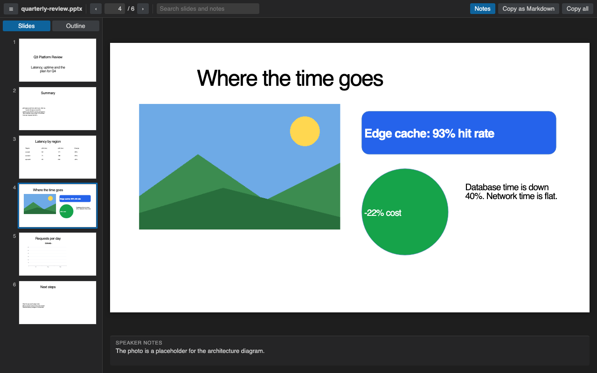

# PPTX Viewer for PowerPoint Slides

Open PowerPoint decks in VS Code and read the slides, speaker notes and every word of text without leaving the editor.

  

*Real output. The extension's own webview renders [`test/fixtures/quarterly-review.pptx`](test/fixtures/quarterly-review.pptx) (made by [`scripts/make-samples.py`](scripts/make-samples.py)) and headless Chromium captures it in [`test/e2e/run.py`](test/e2e/run.py).*

- See each slide with thumbnails, and its speaker notes right under it.
- Search titles, bullets, table cells and notes across the whole deck, then jump to the slide.
- Copy one slide or the whole deck as clean Markdown for a README, an issue or a chat with an AI assistant.

## Quick start

1. Install the extension.
2. Click any `.pptx`, `.ppsx`, `.potx` or `.pptm` file in the Explorer. Press `Ctrl+F` (`Cmd+F` on macOS) to search.

Run "Get Started with PPTX Slide Viewer" from the Welcome page for a short tour.

## Search slides and notes

Type in the search box. The Outline tab lists every slide where the word appears, with the match marked, and says when the match is only in the notes. `Enter` goes to the next matching slide and `Shift+Enter` to the previous one. `Esc` clears the search.

Without a search, the Outline tab shows each slide title with its first lines of text, which is a quick way to skim a long deck.

## Copy as Markdown

"Copy as Markdown" puts the current slide on the clipboard. The title becomes a `##` heading, bullets keep their indent levels, tables become Markdown tables, and the speaker notes become a quote. "Copy all" does the same for every slide. Text that looks like HTML is escaped, so it pastes as text.

## What it draws, and what it doesn't

Slides are drawn with their text boxes, pictures, tables and shapes. Charts are drawn from the numbers saved in the file, so they can look a little different from PowerPoint, and the slide says so.

SmartArt, video, audio, ink and embedded objects are not drawn. A slide that has any of them shows a short message that names them, so you know something is missing.

## Keys

| Key | Action |
| --- | --- |
| `←` `→`, `PageUp` `PageDown`, `Space` | Previous or next slide |
| `Home`, `End` | First or last slide |
| `Ctrl+F` / `Cmd+F` | Search slides and notes |
| `Enter`, `Shift+Enter` in the search box | Next or previous matching slide |

## Settings

| Setting | Default | What it does |
| --- | --- | --- |
| `pptxViewer.maxFileSizeMB` | `150` | Ask before opening larger decks |
| `pptxViewer.showNotes` | `true` | Show speaker notes under the slide |
| `pptxViewer.renderSlides` | `true` | Draw the slides. Set to `false` to see only the outline, notes and search |
| `pptxViewer.askForRating` | `true` | Ask one time for a Marketplace rating, after 5 files and 2 days. Turn it off with `false` |

## Large decks

The extension reads the text of the deck first and skips images and video while it does, so the outline, notes and search are ready before any slide is drawn. A 120-slide test deck parses in about 20 ms. Thumbnails are drawn only as you scroll to them. Above 150 MB the viewer asks before it opens the file.

## Privacy and security

Everything runs on your machine. The extension makes no network calls and has no telemetry. The viewer runs under a strict Content-Security-Policy that allows only the extension's own scripts and blocks all network access. Text from the deck is inserted as plain text, never as HTML. Macros in `.pptm` files are never run, and links inside slides do nothing when clicked.

## Known limits

- It is a viewer. It doesn't edit, present full screen or export to PDF.
- Old binary `.ppt` files (PowerPoint 97 to 2003) are not supported. Save them as `.pptx` first.
- Fonts that are not installed on your machine are replaced, so line breaks can differ from PowerPoint.
- Table styles from the theme are not always drawn. The table text is always correct.
- If another PowerPoint extension is installed, VS Code may ask which one to use. Right-click the file and pick "Open With..." to switch.

## Credits

Slides are drawn by [pptx-preview](https://www.npmjs.com/package/pptx-preview) (ISC), which bundles ECharts (Apache-2.0), JSZip, lodash and uuid. The deck text is read with [fflate](https://github.com/101arrowz/fflate) (MIT). See [THIRD-PARTY-NOTICES.md](THIRD-PARTY-NOTICES.md). The extension itself is MIT licensed.

## More viewers by Zovo

- [Context Drift](https://marketplace.visualstudio.com/items?itemName=zovo.context-drift) finds stale facts in AGENTS.md, CLAUDE.md and other agent rule files.
- [PDF Viewer & Reader with Dark Mode](https://marketplace.visualstudio.com/items?itemName=zovo.pdf-viewer-dark) reads PDFs with a dark mode, search, an outline and thumbnails.
- [CSV, Excel & Parquet Viewer](https://marketplace.visualstudio.com/items?itemName=zovo.table-viewer-vscode) opens Parquet, Excel and CSV files as a sortable, filterable table.
- [DOCX Viewer & Word Viewer](https://marketplace.visualstudio.com/items?itemName=zovo.docx-viewer-vscode) previews Word files with dark mode, an outline and search.
- [HDF5 & NetCDF Explorer](https://marketplace.visualstudio.com/items?itemName=zovo.hdf5-netcdf-explorer) browses groups, variables and attributes in scientific data files.
- [Skill Shelf](https://marketplace.visualstudio.com/items?itemName=zovo.skill-shelf) lists, checks and toggles the Agent Skills that Claude Code, Codex and Cursor load.
- [Tensor Viewer](https://marketplace.visualstudio.com/items?itemName=zovo.tensor-viewer) shows NPY, NPZ, Safetensors and GGUF tensors with stats and heatmaps.
