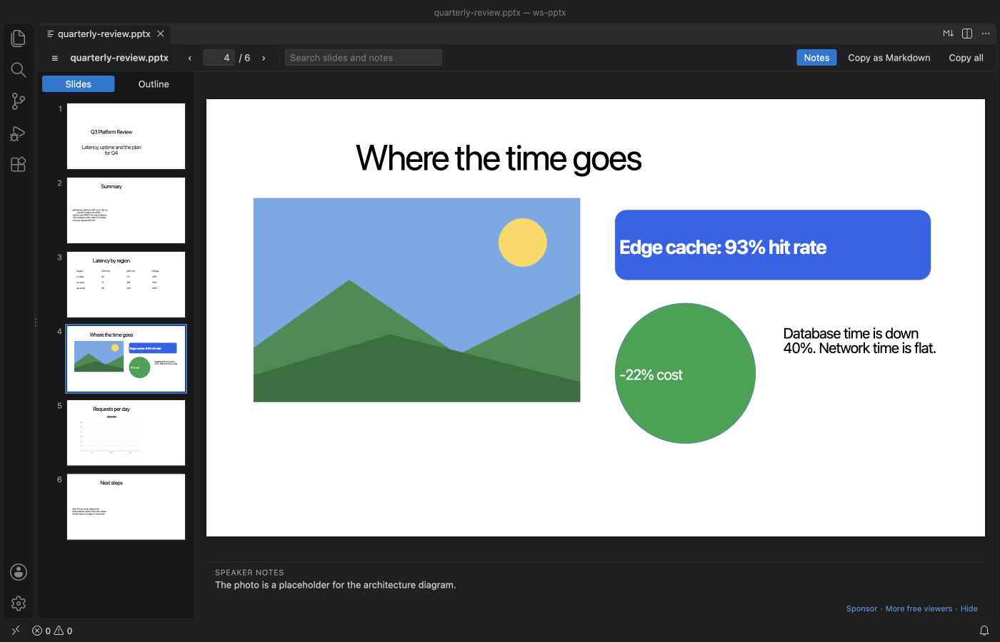

# PPTX Viewer & PowerPoint Viewer

For developers who get slide decks in a repo or a pull request, PPTX Viewer is a PowerPoint viewer that opens your decks in VS Code with thumbnails, speaker notes and search.

  

*A real VS Code 1.142 window running this extension on [`test/fixtures/quarterly-review.pptx`](test/fixtures/quarterly-review.pptx), made by [`scripts/make-samples.py`](scripts/make-samples.py).*

- See each slide with thumbnails and its speaker notes. Zoom in on small print, or scroll through the whole deck like a document.
- Search titles, bullets, table cells and notes across the whole deck, then jump to the slide.
- Copy one slide or the whole deck as clean Markdown for a README, an issue or a chat with an AI assistant.

## Quick start

1. Install the extension.
2. Click any `.pptx`, `.ppsx`, `.potx` or `.pptm` file in the Explorer. Press `Ctrl+F` (`Cmd+F` on macOS) to search.

*Recorded in the same window. The white arrow is drawn in to show where each click lands.*

Run "Get Started with PPTX Slide Viewer" from the Welcome page for a short tour.

## Search slides and notes

Type in the search box. The Outline tab lists every slide where the word appears, with the match marked, and says when the match is only in the notes. `Enter` goes to the next matching slide and `Shift+Enter` to the previous one. `Esc` clears the search.

Without a search, the Outline tab shows each slide title with its first lines of text, which is a quick way to skim a long deck.

## Zoom and scroll view

Use the `-` and `+` buttons or the zoom list in the toolbar. The list has Fit slide, Fit width and fixed sizes from 50% to 400%, and it shows the real percent. `Ctrl` or `Cmd` with the mouse wheel zooms around the mouse, and so does a trackpad pinch. A slide larger than the editor scrolls, so you can read a small table or chart label.

"Scroll" puts every slide in one column, like a document. The slide in view becomes the current one, so the thumbnails, the slide number and the speaker notes follow you as you scroll. Slides are drawn as they come near the view, so a long deck stays fast.

Each file keeps its last view and zoom in the workspace. The settings `pptxViewer.defaultView` and `pptxViewer.defaultZoom` choose how a deck opens the first time.

## Copy as Markdown

"Copy as Markdown" puts the current slide on the clipboard. The title becomes a `##` heading, bullets keep their indent levels, tables become Markdown tables, and the speaker notes become a quote. "Copy all" does the same for every slide. Text that looks like HTML is escaped, so it pastes as text.

## What it draws, and what it doesn't

Slides are drawn with their text boxes, pictures, tables and shapes. Charts are drawn from the numbers saved in the file, so they can look a little different from PowerPoint, and the slide says so.

SmartArt, video, audio, ink and embedded objects are not drawn. A slide that has any of them shows a short message that names them, so you know something is missing.

## Keys

| Key | Action |
| --- | --- |
| `←` `→`, `PageUp` `PageDown`, `Space` | Previous or next slide |
| `Home`, `End` | First or last slide |
| `Ctrl+F` / `Cmd+F` | Search slides and notes |
| `Enter`, `Shift+Enter` in the search box | Next or previous matching slide |
| `+`, `-` | Zoom in or out |
| `Ctrl+=`, `Ctrl+-` / `Cmd+=`, `Cmd+-` | Zoom in or out |
| `Ctrl` / `Cmd` + mouse wheel, trackpad pinch | Zoom around the mouse |
| `0` | Fit the slide in the editor |

## Settings

| Setting | Default | What it does |
| --- | --- | --- |
| `pptxViewer.maxFileSizeMB` | `150` | Ask before opening larger decks |
| `pptxViewer.showNotes` | `true` | Show speaker notes under the slide |
| `pptxViewer.renderSlides` | `true` | Draw the slides. Set to `false` to see only the outline, notes and search |
| `pptxViewer.defaultView` | `slide` | How a deck opens the first time. `slide` shows one slide at a time and `scroll` puts all slides in one column |
| `pptxViewer.defaultZoom` | `fit` | Zoom a deck opens with the first time, `fit` or `width` |
| `pptxViewer.askForRating` | `true` | Ask one time for a Marketplace rating, after 5 files and 2 days. Turn it off with `false` |

## Large decks

The extension reads the text of the deck first and skips images and video while it does, so the outline, notes and search are ready before any slide is drawn. A 120-slide test deck parses in about 20 ms. Thumbnails are drawn only as you scroll to them. Above 150 MB the viewer asks before it opens the file.

## Privacy and security

Everything runs on your machine. The extension makes no network calls and has no telemetry. The viewer runs under a strict Content-Security-Policy that allows only the extension's own scripts and blocks all network access. Text from the deck is inserted as plain text, never as HTML. Macros in `.pptm` files are never run, and links inside slides do nothing when clicked.

## Known limits

- It is a viewer. It doesn't edit, present full screen or export to PDF.
- Old binary `.ppt` files (PowerPoint 97 to 2003) are not supported. Save them as `.pptx` first.
- Fonts that are not installed on your machine are replaced, so line breaks can differ from PowerPoint.
- Table styles from the theme are not always drawn. The table text is always correct.
- Zoom changes the drawn slides. The text view, shown while slides are drawn or when drawing is off, keeps its normal size.
- If another PowerPoint extension is installed, VS Code may ask which one to use. Right-click the file and pick "Open With..." to switch.

## Credits

Slides are drawn by [pptx-preview](https://www.npmjs.com/package/pptx-preview) (ISC), which bundles ECharts (Apache-2.0), JSZip, lodash and uuid. The deck text is read with [fflate](https://github.com/101arrowz/fflate) (MIT). See [THIRD-PARTY-NOTICES.md](THIRD-PARTY-NOTICES.md). The extension itself is MIT licensed.

## Support Zovo

Zovo extensions are free, with no ads and no tracking. They are made by [theluckystrike](https://github.com/theluckystrike) on GitHub. If this one saves you time, you can support the work:

- [Sponsor on GitHub](https://github.com/sponsors/theluckystrike)
- [Follow theluckystrike on GitHub](https://github.com/theluckystrike)

## More tools by Zovo

- [DOCX Viewer & Word Viewer with Dark Mode](https://marketplace.visualstudio.com/items?itemName=zovo.docx-viewer-vscode) previews Word and ODT files with dark mode, an outline and search.
- [PDF Viewer & PDF Reader with Dark Mode](https://marketplace.visualstudio.com/items?itemName=zovo.pdf-viewer-dark) reads PDFs with a real dark mode, search, an outline and thumbnails.
- [CSV Viewer, Excel Viewer (XLSX) & Parquet Viewer](https://marketplace.visualstudio.com/items?itemName=zovo.table-viewer-vscode) opens CSV, TSV, Excel and Parquet files as a sortable, filterable table.
- [Graphviz Preview & DOT Viewer](https://marketplace.visualstudio.com/items?itemName=zovo.zovo-graphviz-preview) shows a live preview of DOT files and exports SVG or PNG.

See [all Zovo extensions on the Marketplace](https://marketplace.visualstudio.com/publishers/zovo).
