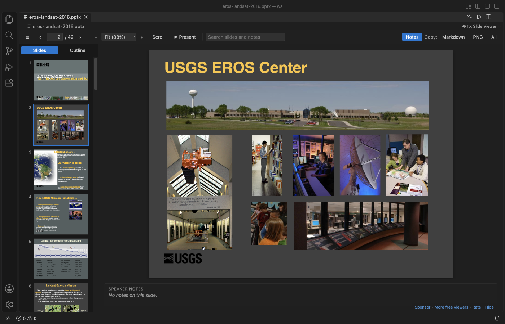
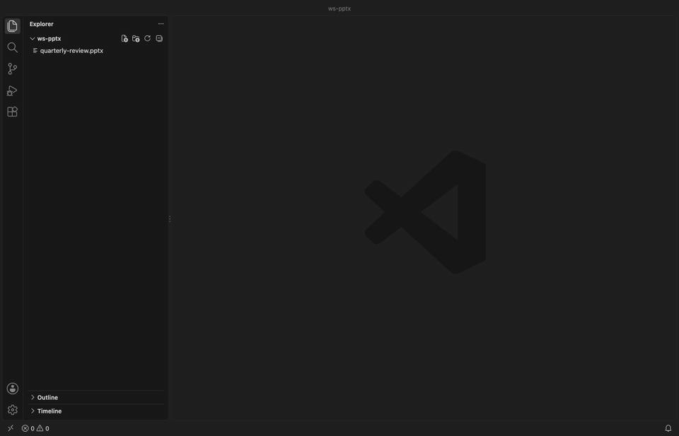
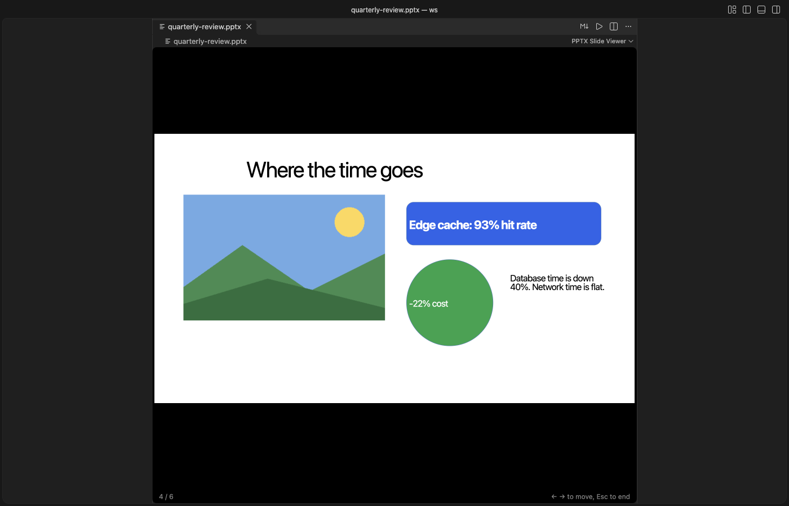
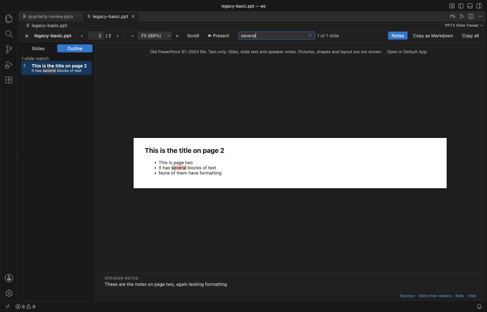
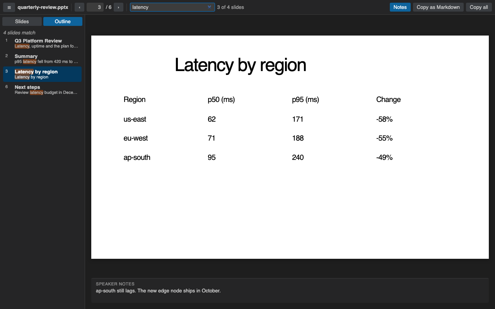
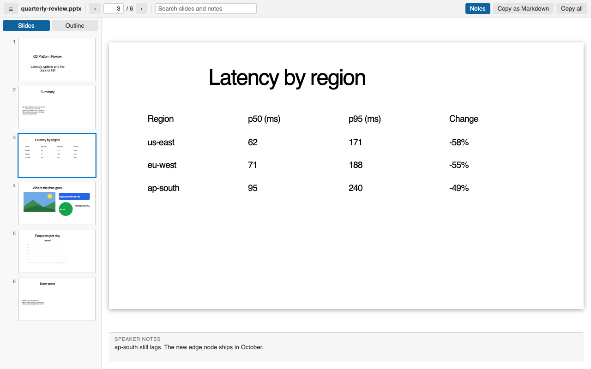

# PPTX Viewer & PowerPoint Preview, PPT Presentation Slideshow

PPTX Viewer opens PowerPoint decks right in VS Code: `.pptx`, `.ppsx`, `.potx` and old `.ppt` files, with thumbnails, speaker notes, search and full screen Present. Check a deck that a script, python-pptx or an AI agent (Claude Code, Copilot, Cursor) just wrote: the slide reloads each time the file is saved. It reads files through VS Code, so it also works over Remote SSH, WSL, Dev Containers and Codespaces. No LibreOffice, no upload.

  

*A real VS Code window running version 0.4.0 on a public 197 MB, 42-slide deck from the U.S. Geological Survey (public domain). The first slide showed in about 5 seconds.*

- Slides look closer to PowerPoint: text sizes, bullets and fonts come from the slide master and layout, the way PowerPoint reads them, and SmartArt saved by PowerPoint is drawn.
- Live reload: when another program saves the deck, the open slide updates within about a second.
- Copy a slide as a PNG picture for a pull request, an issue or a chat, or save it as a `.png` file.
- Present right from VS Code: one slide at a time on a black screen, full screen, with the arrow keys or a click. Esc brings your editor back.
- Old PowerPoint 97-2003 `.ppt` files open too, as text with titles, slide text and speaker notes. Search and Copy as Markdown work on them.
- See each slide with thumbnails and its speaker notes. Zoom in on small print, or scroll through the whole deck like a document.
- Search titles, bullets, table cells and notes across the whole deck, then jump to the slide.
- Copy one slide or the whole deck as clean Markdown for a README, an issue or a chat with an AI assistant.

## Quick start

1. Install the extension.
2. Click any `.pptx`, `.ppsx`, `.potx`, `.pptm` or `.ppt` file in the Explorer. Press `Ctrl+F` (`Cmd+F` on macOS) to search.

*Recorded in the same window. The white arrow is drawn in to show where each click lands.*

Run "Get Started with PPTX Slide Viewer" from the Welcome page for a short tour.

## Present

Click "Present" in the toolbar, or run "PPTX: Present Slides (Full Screen)". The current slide fills the screen on black. `→`, `↓`, `Space`, `Page Down`, `Enter` or a click go to the next slide; `←`, `↑`, `Page Up` or `Backspace` go back; `Home` and `End` jump to the first and last slide. `Esc` ends it. VS Code switches to Zen Mode (full screen, no side bars) while you present and switches back on `Esc`. Set `pptxViewer.presentFullScreen` to `false` to present inside the editor tab only.

## Old .ppt files (PowerPoint 97-2003)

`.ppt`, `.pps` and `.pot` files open as text: each slide's title, its text and text boxes, and its speaker notes, in slide order. The outline, search, the notes pane and Copy as Markdown work as they do for `.pptx`. A line at the top says the file is text only, because pictures, shapes and layout are not read, and its "Open in Default App" button opens the file in PowerPoint or Keynote. The file is read by the extension itself, so nothing else needs to be installed. A `.pptx` deck that was saved with a `.ppt` name is spotted by its first bytes and drawn as a normal deck. Password-protected and damaged files get a message, never an empty page.

## Search slides and notes

Type in the search box. The Outline tab lists every slide where the word appears, with the match marked, and says when the match is only in the notes. `Enter` goes to the next matching slide and `Shift+Enter` to the previous one. `Esc` clears the search.

Without a search, the Outline tab shows each slide title with its first lines of text, which is a quick way to skim a long deck.

## Zoom and scroll view

Use the `-` and `+` buttons or the zoom list in the toolbar. The list has Fit slide, Fit width and fixed sizes from 50% to 400%, and it shows the real percent. `Ctrl` or `Cmd` with the mouse wheel zooms around the mouse, and so does a trackpad pinch. A slide larger than the editor scrolls, so you can read a small table or chart label.

"Scroll" puts every slide in one column, like a document. The slide in view becomes the current one, so the thumbnails, the slide number and the speaker notes follow you as you scroll. Slides are drawn as they come near the view, so a long deck stays fast.

Each file keeps its last view and zoom in the workspace. The settings `pptxViewer.defaultView` and `pptxViewer.defaultZoom` choose how a deck opens the first time.

## Live reload for generated decks

Keep the deck open while a script or an AI agent rebuilds it. Each time the file is saved, the viewer reads it again and stays on the slide you were looking at. A file that is still empty or half written shows a short message, and it opens by itself when the write is done. This works for files that other programs change, not only for edits made in VS Code.

## Copy a slide as PNG

Copy: "PNG" in the toolbar puts the current slide on the clipboard as a picture, about 1920 pixels wide. Shift+click it, or run "PPTX: Save Slide as PNG…", to save the picture as a file next to the deck. The picture is made on your machine from the drawn slide.

## Copy as Markdown

Copy: "Markdown" in the toolbar puts the current slide on the clipboard. The title becomes a `##` heading, bullets keep their indent levels, tables become Markdown tables, and the speaker notes become a quote. Copy: "All" does the same for every slide. Text that looks like HTML is escaped, so it pastes as text.

## What it draws, and what it doesn't

Slides are drawn with their text boxes, pictures, tables and shapes. Text takes its size, bullets, font and position from the slide master and layout, as in PowerPoint, so decks made with python-pptx or other tools look right. Charts are drawn from the numbers saved in the file, so they can look a little different from PowerPoint, and the slide says so. SmartArt is drawn from the copy that PowerPoint saves with it.

Video, audio, ink, embedded objects and SmartArt saved without that copy are not drawn. A slide that has any of them shows a short message that names them, so you know something is missing. If a single slide cannot be drawn, that slide shows its text with a note, and the other slides draw as usual.

## Keys

| Key | Action |
| --- | --- |
| `←` `→`, `PageUp` `PageDown`, `Space` | Previous or next slide |
| `Home`, `End` | First or last slide |
| `Ctrl+F` / `Cmd+F` | Search slides and notes |
| `Enter`, `Shift+Enter` in the search box | Next or previous matching slide |
| `+`, `-` | Zoom in or out |
| `Ctrl+=`, `Ctrl+-` / `Cmd+=`, `Cmd+-` | Zoom in or out |
| `Ctrl` / `Cmd` + mouse wheel, trackpad pinch | Zoom around the mouse |
| `0` | Fit the slide in the editor |

## Settings

| Setting | Default | What it does |
| --- | --- | --- |
| `pptxViewer.maxFileSizeMB` | `300` | Ask before opening larger decks |
| `pptxViewer.showNotes` | `true` | Show speaker notes under the slide |
| `pptxViewer.renderSlides` | `true` | Draw the slides. Set to `false` to see only the outline, notes and search |
| `pptxViewer.defaultView` | `slide` | How a deck opens the first time. `slide` shows one slide at a time and `scroll` puts all slides in one column |
| `pptxViewer.defaultZoom` | `fit` | Zoom a deck opens with the first time, `fit` or `width` |
| `pptxViewer.presentFullScreen` | `true` | Present switches VS Code to Zen Mode (full screen) and back on Esc. `false` presents inside the editor tab |
| `pptxViewer.askForRating` | `true` | Ask for a Marketplace rating after 3 files opened without an error on 2 different days. "Later" asks one more time after 7 days, "No thanks" never again. It never asks after an error. Turn it off with `false`. |

## Large decks

The extension reads the text of the deck first and skips images and video while it does, so the outline, notes and search are ready before any slide is drawn. Slides are then drawn one at a time, when you first look at them, and thumbnails only as you scroll to them. In a real VS Code window on a MacBook, a public 197 MB, 42-slide USGS deck showed its outline in under a second and its first slide in about 5 seconds, and a 33 MB, 37-slide deck in about 2 seconds. Above 300 MB the viewer asks before it opens the file.

## Free and Zovo Pro

This viewer is free and complete. Nothing in it is paid, and every feature it has today stays free.

Zovo Pro is optional: USD 15, paid once, for every Zovo VS Code viewer. Today it adds Pro features in [Hex Viewer](https://marketplace.visualstudio.com/items?itemName=zovo.zovo-hex-viewer) (binary templates with a structure view, bookmarks, checksums and compare reports). Pro features that come to other Zovo viewers later are included, this one too if it gets any. See [what Zovo Pro includes](https://theluckystrike.github.io/zovo-plugin-factory/pro.html).

## Privacy and security

Everything runs on your machine. The extension makes no network calls and has no telemetry. The viewer runs under a strict Content-Security-Policy that allows only the extension's own scripts and blocks all network access. Text from the deck is inserted as plain text, never as HTML. Macros in `.pptm` files are never run, and links inside slides do nothing when clicked.

## Known limits

- It is a viewer. It doesn't edit or export to PDF (a single slide can be saved as PNG). Present mode has no presenter view or timer.
- Old binary `.ppt` files (PowerPoint 97 to 2003) show text only: no pictures, shapes, tables or layout. Bullet levels show flat.
- Fonts that are not installed on your machine are replaced by a close match (Carlito for Calibri, Caladea for Cambria, then a common sans or serif font), so line breaks can differ a little from PowerPoint.
- Table styles from the theme are not always drawn. The table text is always correct.
- Zoom changes the drawn slides. The text view, shown while slides are drawn or when drawing is off, keeps its normal size.
- If another PowerPoint extension is installed, VS Code may ask which one to use. Right-click the file and pick "Open With..." to switch.

## Credits

Slides are drawn by [pptx-preview](https://www.npmjs.com/package/pptx-preview) (ISC), which bundles ECharts (Apache-2.0), JSZip, lodash and uuid. The deck text is read with [fflate](https://github.com/101arrowz/fflate) (MIT). See [THIRD-PARTY-NOTICES.md](THIRD-PARTY-NOTICES.md). The extension itself is MIT licensed.

## Support Zovo

Zovo extensions are free, with no ads and no tracking. They are made by [theluckystrike](https://github.com/theluckystrike) on GitHub. If this one saves you time, you can support the work:

- [Sponsor on GitHub](https://github.com/sponsors/theluckystrike)
- [PayPal](https://www.paypal.com/paypalme/najzzz)
- [Follow theluckystrike on GitHub](https://github.com/theluckystrike)

## More tools by Zovo

- [Office Viewer Pack](https://marketplace.visualstudio.com/items?itemName=zovo.zovo-file-viewers): adds the other three Office viewers in one install.
- [DOCX Viewer & ODT Viewer, Word Document Preview (Dark Mode)](https://marketplace.visualstudio.com/items?itemName=zovo.docx-viewer-vscode) previews Word and ODT files with dark mode, an outline and search.
- [PDF Viewer & Reader to Read and View PDF in Dark Mode](https://marketplace.visualstudio.com/items?itemName=zovo.pdf-viewer-dark) reads PDFs with a real dark mode, search, an outline and thumbnails.
- [XLSX Viewer & CSV Preview for Excel, XLS & Parquet](https://marketplace.visualstudio.com/items?itemName=zovo.table-viewer-vscode) opens CSV, TSV, Excel and Parquet files as a sortable, filterable table.
- [Graphviz Viewer & DOT Viewer (Live Preview)](https://marketplace.visualstudio.com/items?itemName=zovo.zovo-graphviz-preview) shows a live preview of DOT files and exports SVG or PNG.

See [all Zovo extensions on the Marketplace](https://marketplace.visualstudio.com/publishers/zovo).
